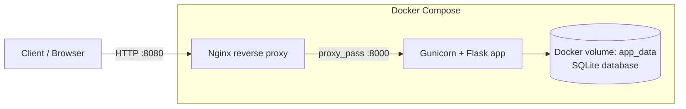

# Dockerized Web Application


A small Python (Flask) task-tracker API packaged the way I would ship a service to production: a multi-stage Docker image running as a non-root user, Gunicorn as the app server, Nginx as a reverse proxy, health checks, environment-based configuration and a persistent Docker volume for data.

> Portfolio project built to practise containerisation. It is not a commercial production deployment.

## Architecture



## Features

- **Multi-stage Dockerfile:** dependencies are built in one stage and copied into a slim runtime image that runs as an unprivileged `app` user.
- **Nginx reverse proxy:** forwarding headers, security headers, request size limit and its own health endpoint.
- **Health checks:** in both the image (`HEALTHCHECK`) and Compose. Nginx waits for the app to be healthy before starting.
- **Persistent storage:** the SQLite database lives on the named volume `app_data`, so data survives restarts and rebuilds.
- **Twelve-factor config:** all settings come from environment variables (`.env`).
- **CI (GitHub Actions):**
  - lint and unit tests
  - builds the full stack, smoke tests it through Nginx
  - restarts the app container to prove the data persists

## Tech stack

Docker · Docker Compose · Nginx · Python 3.12 · Flask · Gunicorn · SQLite · GitHub Actions · Linux

## Project structure

```
.
├── app/                 # Flask application (API + DB layer)
├── nginx/nginx.conf     # Reverse proxy config
├── scripts/smoke_test.sh
├── tests/               # pytest unit tests
├── Dockerfile           # Multi-stage, non-root image
├── docker-compose.yml   # web + nginx + volume
├── .env.example
└── .github/workflows/ci.yml
```

## Run it locally

Requirements: Docker with the Compose plugin.

```bash
git clone https://github.com/AmanMasood/dockerized-web-application.git
cd dockerized-web-application
cp .env.example .env
docker compose up -d --build
./scripts/smoke_test.sh http://localhost:8080
```

### API

| Method | Path | Description |
|---|---|---|
| GET | `/health` | App + database health, hostname, uptime |
| GET | `/api/tasks` | List tasks |
| POST | `/api/tasks` | Create a task: `{"title": "..."}` |
| PATCH | `/api/tasks/<id>` | Update `title` / `done` |
| DELETE | `/api/tasks/<id>` | Delete a task |

```bash
curl -X POST localhost:8080/api/tasks -H 'Content-Type: application/json' -d '{"title":"learn docker"}'
curl localhost:8080/api/tasks
```

## Configuration

| Variable | Default | Purpose |
|---|---|---|
| `APP_ENV` | `development` | Shown in `/health` |
| `DATABASE_PATH` | `/data/app.db` | SQLite file location (on the volume) |
| `HTTP_PORT` | `8080` | Host port published by Nginx |

## Deployment notes

- Stop the stack with `docker compose down`. Your data is kept. `docker compose down -v` removes the volume as well.
- Back up the data by copying the database out of the volume: `docker compose cp web:/data/app.db ./backup.db`.
- To serve HTTPS, put a certificate in front of Nginx. The [automated-cloud-deployment](https://github.com/AmanMasood/automated-cloud-deployment) project shows how.

## Testing

```bash
pip install -r requirements-dev.txt
python -m pytest -q
```

Unit tests run locally. The full Docker stack is built and smoke-tested on every push by GitHub Actions; see the CI badge above.

## License

MIT
